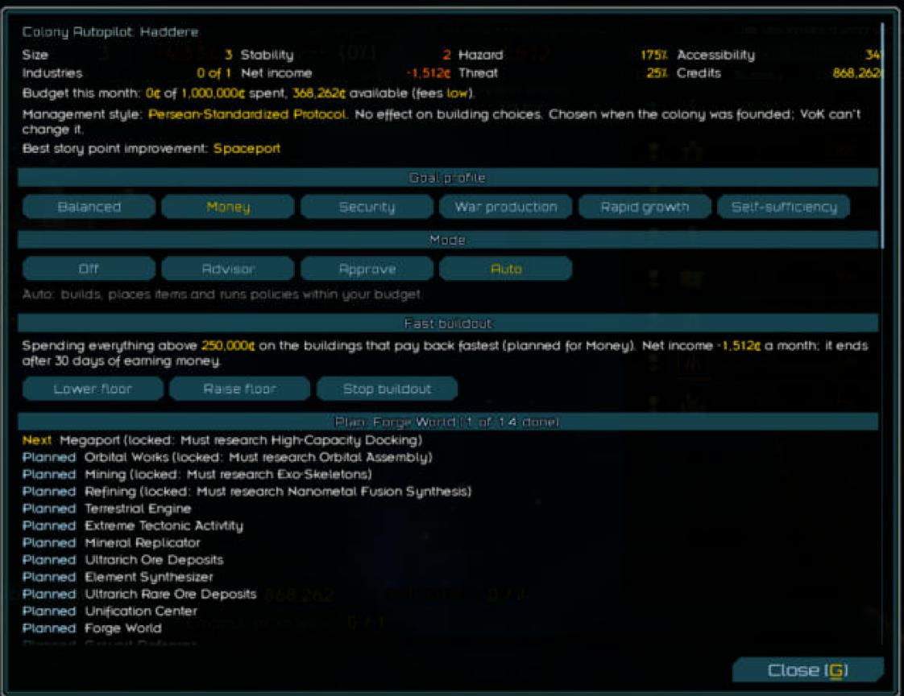
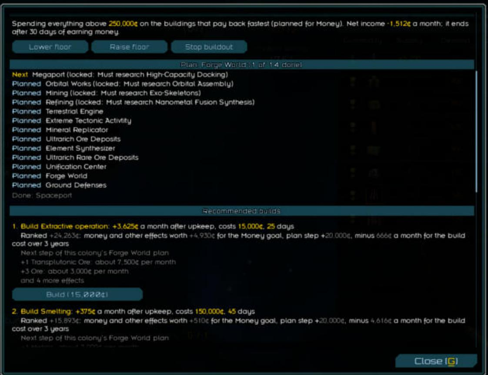
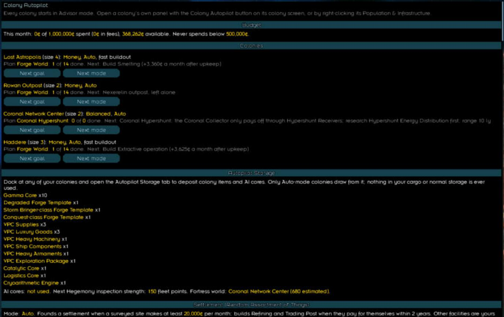
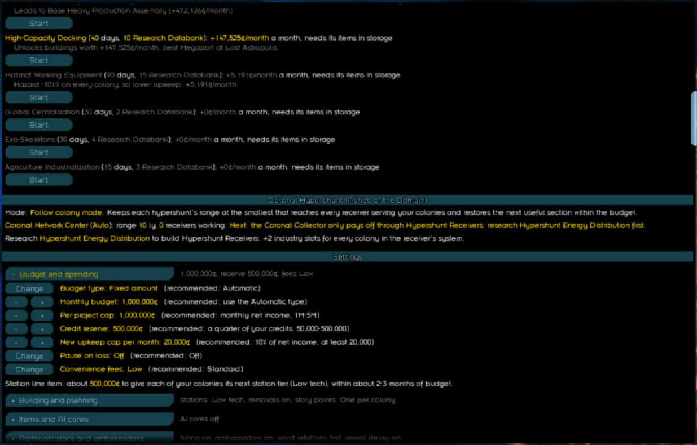

# Jonah's Colony Manager

> [!WARNING]
> **AI-generated.** Mod, docs and build checks written by AI coding agents. Compiled and checked offline (bytecode
> verification against every combination of the optional mods) Expect bugs. Report them as [issues](https://github.com/Mjolniar/jonahs-colony-manager/issues) with
> `starsector-core/starsector.log` and `saves/common/colony_autopilot_diagnostics.json.data` if you have the time/willingness to dig logs, otherwise it's chill to just throw it in issues anyway, whatever problem is occurring with the mod installed. It would be good to know your modlist if you do have an issue to see what is incompatible with the mod so I can get that fixed.

This is a mod I had Claude Code create for me due to always liking to have tons of colonies with lots of buildings, limits off, etc, but always getting way in over my head with management. 
The goal of the mod is to let you simply flick the automatic switch on colonies (right click population and infrastructure, top left card in colony, and it's the bottom option) and have them take care of themselves, so long as you have the cash to keep them improving. There's several modes to choose from, tons of options involving governors, buildings, how you want the colony to develop, and so on!

By default, most of the settings will try to optimize your colonies to protect them and make them profitable, for a small convenience fee per building placed and action taken. To have it add items to your colonies, there is a colony storage you can access at any of your owned colonies where you can put all colony augment items (nanoforge, ai cores, etc.) - this has extensive modded support as well. The manager will automatically pick an optimal planet goal according to what you settle to "optimize" the planet, but that can freely be changed according to what you want. I highly suggest editing all options to your taste, and they're editable on the fly from the colony threat tab in the intel screen.

This mod is currently working with most of the colony mods I could find on the main star sector mod page, but if you would like one added to its functionality please put it into the issues tab and I'll do it asap.

## Features

- **Modes per colony:** Off, Advisor, Approve, Auto. Auto builds within your budget.
- **Goals:** Balanced, Money, Security, War production, Rapid growth, Self-sufficiency.
- **Plans:** target layout from planet, hazards, resources.
- **Budget:** Automatic by default (half of net income plus 15% of savings above a reserve), per-project cap, convenience fees. The recommended settings are meant to work if you only switch colonies to Auto.
- **Fast buildout:** after you found your first colony, a popup offers to spend everything above a floor you choose (default 250,000) on the fastest-paying builds until the colony earns money. Any losing colony can start one from its panel.
- **Threat response:** Security at 70% threat; back below 65% after 60 days.
- **Items and AI cores:** placed from Autopilot Storage only.
- **Administrators:** idle ones assigned; hiring optional.
- **Mod buildings:** measured on a probe colony, then scored like vanilla.
- **Diagnostics:** every building rated Supported, Measured, Analyzed or Quarantined.
- **No balance changes.** Battle size, sticky combat autopilot and other easier-game changes are in [Jonah's Easy Sector](https://github.com/Mjolniar/jonahs-easy-sector).
- **Mod updates:** each integration is health-checked on load; mod values are read live; estimates are calibrated against real results; an action that keeps failing is paused for the session.

## Integrations

All optional. Each loads only when its mod is enabled. **[What each supported mod adds](docs/supported-mods.md)** explains each one in plain terms.

| Mod | Adds |
|---|---|
| Terraforming Made Easy | Special-world plans, terraforming |
| Industrial Evolution | Ambassadors, edicts, VPC chips, courier shipping |
| Nexerelin | Emergency defense fleets; agents (off by default): defense against rebellions, Pather cells, pirate bases and enemy operations, optional sabotage of factions at war with you, auto-hiring |
| Emergent Threats | Antimatter Stabilizer conversion |
| Ashes of the Domain | Research choices, research locks, upgrade paths, starter buildings, industry synergies, management styles, trade contracts, megastructures (Coronal Hypershunt, Pluto, Nidavelir), AotD colony items |
| Random Assortment of Things | Frontiers settlement: found and develop |
| Station Augments | Best augment loadout per station, within its AP |
| Terraforming & Station Construction | Terraforming projects, prerequisite buildings, building estimates |
| Grand.Colonies | Cramped-upkeep cost on builds past the limit |
| Substance.Abuse | Brewery built for recipes in storage |
| Volkov Industrial Conglomerate | Viral contamination treatment, soil nanites |
| Roider Union | Dives and Union HQ remote mining |
| Planetary Shield: Access Control | Shield value, closed-port rule |
| Unknown Skies, What We Left Behind, Astral Ascension | Mining bonuses, water worlds, growth limit |
| Any mod | Deposit conditions and colony items through the game's own tables; 12-building screen limit |

## Screenshots

**Colony panel:** stats, goal and mode, fast buildout, and the plan with research locks.



**Recommended builds:** money a month after upkeep, and how each option's ranking is made up.



**Empire panel:** budget, every colony with its plan and next build, and Autopilot Storage.



**Research and settings:** research ranked by what it unlocks, the hypershunt, and settings with their recommendations.



## Install

1. Download the zip from the [latest release](https://github.com/Mjolniar/jonahs-colony-manager/releases/latest) and extract it into `Starsector/mods/`.
2. Enable **Jonah's Colony Manager** in the launcher. No required mods. (Formerly Jonah Tweaks; same mod id, so existing saves keep working.)

## Use

**New here? Read [Getting started](docs/getting-started.md)**: the panels, your first colony step by step (including the fast buildout popup), agents, and the first-colony budget trap. Then [What each supported mod adds](docs/supported-mods.md).

- **Colony:** the **Colony Autopilot** button on the colony screen, or right-click Population & Infrastructure, **Colony Autopilot...**
- **Empire:** Intel, **Colony threats** (or Important), **Colony Autopilot**.

Quick start: pick a goal in the colony panel and build from **Recommended builds** in Advisor. Then switch to Approve or Auto; the first switch opens setup with recommended settings. For a new colony, say yes to the fast buildout popup. Otherwise, if Auto builds nothing on a young colony, check the budget line: a negative net income or a credit reserve above your bank balance stops spending (see the guide).

## Notes

- Advisor is the default; nothing is built until you choose Approve or Auto.
- Don't remove from a save that used it (Autopilot Storage is a market tab).
- Full rules: [docs/details.md](docs/details.md).

## Source

**[Source guide](docs/source-guide.md)**: how the code is laid out, what happens each day, how buildings are scored, how optional mods stay optional, what's saved, and what every file does.

## Build

JDK 17, sources in `src/`:

```
javac --release 17 -cp "<core jars>;<optional mod jars>" -d build <all .java files under src>
jar cf jars/jonahtweaks.jar -C build data
```

Core jars: `starfarer.api.jar`, `starfarer_obf.jar`, `fs.common_obf.jar`, `log4j-1.2.9.jar`, `json.jar`, `lwjgl.jar`, `lwjgl_util.jar`. Optional: Terraforming Made Easy, Industrial Evolution, Nexerelin, Random Assortment of Things, Station Augments (plus LazyLib's Kotlin runtime and LunaLib).
